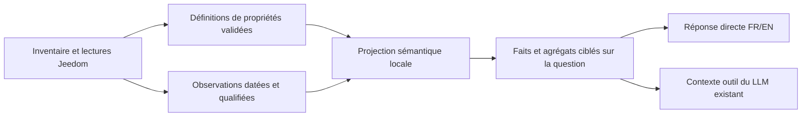

# Étude : des états Jeedom aux faits utilisables par Aria

2026-10-21 — **Proposition, non implémentée.** Étude du code et du cache du serveur,
sans redémarrage, action domotique ni manipulation audio. La stratégie de contrôle
D-001 reste ouverte. Le traitement recommandé est local, sur le Xeon existant,
sans modèle supplémentaire ni inférence à chaque événement.

2026-11-10 : le [pilote lumières/volets](status-pilot-2026-11-10.md) implémente un
sous-ensemble de cette proposition ; les autres domaines et extensions restent à étudier.

## Résultat recherché

À « Quel est l’état des lumières ? », répondre par une synthèse compréhensible,
puis proposer les détails utiles. Éviter d’énumérer des noms techniques et des
valeurs sans signification. Le même socle doit alimenter les réponses directes,
les outils du LLM et, ultérieurement, le moniteur.

Exemple **fictif**, si les observations sont suffisamment documentées :
« Une lumière est allumée dans la pièce A. Dans la pièce B, une lumière sur deux
est allumée. Je ne connais pas l’état des lumières de la pièce C. » Si l’heure de collecte manque, qualifier ces états comme
les valeurs rapportées par Jeedom, sans prétendre à une vérification physique actuelle.

Il faut séparer trois problèmes : retrouver le bon équipement ; comprendre sa
valeur ; exprimer les faits. Les synonymes et la recherche sémantique aident le
premier. Ils ne déterminent pas si `1` veut dire ouvert, fermé ou alarme active.

## Ce que le code et les données montrent

Source étudiée : `codex/lights-questions`, base main `7ba8250`, avec le correctif
lumières non commité décrit dans [le bilan associé](light-questions-2026-10-21.md).
Les identifiants, noms réels et adresses restent dans les fichiers locaux ignorés.

Audit reproductible du cache normalisé copié en lecture seule depuis le serveur :

| Élément | Constat |
| --- | --- |
| Inventaire | 70 équipements, 2 638 commandes, dont 2 383 `info` |
| Capacités précises reconnues | 32 : 5 `light_state`, 3 `flap_state`, 8 `power`, 16 `consumption` |
| Autres informations | 903 `generic_info`, 1 448 sans capacité reconnue |
| Numériques | 1 881 ; seulement 15 ont une plage explicite dans ce cache |
| Lumières | 4 équipements, 5 états : trois équipements simples et un à deux canaux |
| Volets | 3 états numériques en `%`, sans plage dans le cache ni convention d’ouverture |
| Complétude | `catalog_complete=false` ; le cache ne contient pas les observations courantes |

Ces nombres décrivent **ce cache**, pas une certification de tous les équipements
de la maison. « Non reconnu » n’établit pas que Jeedom est mal configuré : le mapping
Aria est limité et ne conserve pas les types génériques inconnus.

Le classement actuel par capacité ou mots du nom (`metric_for`) attribue une mesure
à 324 commandes. Ce n’est pas une validation sémantique :

- `wind` regroupe 22 valeurs numériques en km/h, 26 en degrés et 16 chaînes ;
- `rain` regroupe notamment 3 pourcentages et 39 commandes en mm, numériques ou texte ;
- `energy` regroupe 15 commandes en kWh et une en m³.

Une direction du vent n’est pas une vitesse ; une probabilité de pluie n’est pas une
hauteur de précipitations ; un volume ne devient pas de l’énergie sans conversion
documentée. Le nom seul ne suffit donc pas à produire un fait fiable.

Points d’entrée vérifiés par Serena et navigation GitNexus :

| Code | Rôle et limite actuels |
| --- | --- |
| [models.py](../../app/plugins/inventory/models.py) | Identité, capacité, unité, plage ; pas de définition typée de propriété, de période ou de polarité |
| [normalizer.py](../../app/plugins/inventory/normalizer.py) | Mapping restreint ; `normalize_event` date la réception avec l’horloge locale, pas la mesure du capteur |
| [read_bridge.py](../../app/plugins/inventory/read_bridge.py) | Lecture bornée à 8 infos ; `retrieved_at` connu, `observed_at=null` ; événements comptés, non projetés en états |
| [state_read.py](../../app/plugins/inventory/state_read.py) | Mesures reconnues par mots/capacités, rendu surtout nom + valeur + unité ; date inconnue signalée |
| [light_queries.py](../../app/plugins/inventory/light_queries.py) | Première sémantique spécialisée : allumé/éteint, canaux, état mixte/incomplet et agrégats |
| [read_requests.py](../../app/plugins/inventory/read_requests.py) | Résolution et clarification avant lecture ; réponses directes sans inférence |
| [tools.py](../../app/llm/tools.py) | `get_device_state` retourne les lectures ; le formateur générique ne définit pas leur sens et peut retomber sur le JSON brut |

Les lectures Jeedom sont déjà possibles : le manque principal est le **contrat de
signification partagé**, pas un nouveau transport ou un nouveau modèle.
Les preuves privées de cette étude sont dans `.local/status-semantics/` du checkout
canonique : `inventory.json`, `audit.py`, `enrich_audit.py`, `audit.json`.
Empreinte du cache : `5321bb61fc82d8c41ec06286faf2025d3c5690e7dc1c00f9fb22e8018d5e318a`.

## Options et recommandation

| Option | Avantage | Limite | Avis pour Aria |
| --- | --- | --- | --- |
| Événements bruts dans le prompt | Peu de préparation | Bruit, unités/périodes ambiguës, contexte et préchargement coûteux | Écarter |
| LLM interprète chaque événement | Souplesse apparente | Coût permanent, latence, interprétations variables | Écarter |
| Modèle sémantique complet avec moteur RDF | Vocabulaire formel extensible | Complexité et dépendances disproportionnées au besoin immédiat | Référence conceptuelle seulement |
| Propriétés typées + règles locales + faits ciblés | Déterministe, explicable, coût borné, réutilisable | Nécessite des mappings et quelques réglages locaux | **Recommandé** |

S’inspirer de la séparation propriété/action/événement du
[W3C WoT](https://www.w3.org/TR/wot-thing-description/), qui décrit aussi types,
unités et contraintes ; ne pas ajouter son runtime ni charger des ontologies sur Internet.
Home Assistant sépare également la grandeur mesurée, son unité et sa classe
statistique dans son [contrat Sensor](https://contributors.home-assistant.io/core/entities/sensor/).
Ces références guident la proposition ; elles ne prouvent pas le comportement d’Aria.

## Contrat de faits recommandé

Le [contrat détaillé](jeedom-status-contract-2026-10-21.md) définit les propriétés,
observations et faits, les règles par domaine, la fraîcheur, l’exhaustivité et le
paquet JSON destiné au LLM. Il sépare notamment :

- identité/canal et label ; valeur mesurée, consigne et commande ;
- unité, grandeur, polarité, période et provenance du mapping ;
- heure de réception, collecte et changement ; valeur valide, ancienne ou inconnue ;
- couverture des lectures et complétude du catalogue ; équipement et circuit.

L’interprétation repose sur des métadonnées ou des réglages validés. Les noms et
synonymes servent à retrouver la source ; ils ne suffisent pas à définir sa signification.
Les réponses simples restent déterministes en français/anglais. Pour les demandes
composées, le LLM existant reçoit uniquement les faits ciblés, avec les limites qui
empêchent de les généraliser. Aucun nouveau modèle n’est nécessaire.

## Intégration et validation proposées

Éviter de recopier la logique dans un parseur par domaine et dans un outil LLM.
Ajouter une projection partagée après acquisition/validation, réutilisée par
`answer_read_request`, `render_light_states` et le résultat de `get_device_state`.
Maintenir l’autorisation d’action séparée : un fait ou un ID lu n’autorise rien.
Un événement d’état ne prouve pas la causalité d’une action ; en log-only, aucune
réponse ne doit annoncer qu’un appareil a été réellement changé.

Ordre recommandé, sans engagement d’implémentation dans cette étude :

1. **Pilote lumières + volets** : contrat partagé, canaux, polarité documentée,
   incertitude et couverture ; conserver les comportements de sélection/clarification.
   Les volets sans mapping restent non interprétés, sans actuation de calibration.
2. **Qualité des métadonnées** : conserver types génériques, unités et rôles ;
   rapport local des propriétés non interprétables ; réglages privés minimaux avec
   provenance. Étudier l’enveloppe de dates dans le plugin seulement si nécessaire.
3. **Météo, température et compteurs** : séparer grandeurs/périodes et sources avant
   d’ajouter synthèses temporelles, tendances ou jugements « normal/anormal ».

Cache de définitions compilées en mémoire ; observations et provenance bornées.
Réutiliser la limite de 8 lectures, les files et les délais du pont. Sans dates source
fiables, le cache événementiel ne remplace pas une lecture à la demande. Aucun polling
intensif ni hausse de concurrence requis. Une actualisation quotidienne du catalogue
ne rend pas fraîches les observations. Les réglages par installation restent dans
`.env.local` / `.local/`, avec exemples fictifs seulement dans le dépôt public.

Avant activation, mode **shadow** : comparer ancien/nouveau sens sur les mêmes
lectures, sans modifier les réponses ni les commandes. Corpus FR/EN inédit couvrant
nom exact, synonymes, portée, ambiguïté et clarification ; cas numériques 0/1/99,
valeurs hors plage/sentinelles, polarités opposées, canaux mixtes/manquants, date absente,
retard/reconnexion, capteur inchangé, sources contradictoires, doublons et catalogue
incomplet. Vérifier séparément vitesse/direction, cumul/probabilité, observation/prévision,
consigne/mesure, W/Wh/m³ et périodes. Les oracles viennent des observations et mappings
validés, pas de la vraisemblance d’une phrase ou d’un LLM juge seul.

Mesurer sur le serveur, même modèle/prompt/historique et mêmes observations : CPU/RSS,
temps de projection p50/p95, taille/tokens du paquet, lecture réseau, queue, génération,
TTS et délai jusqu’au premier WAV utile. Comparer aussi la durée d’écoute des rapports.
Budget de départ **proposé, non mesuré et non SLO** : projection p95 < 5 ms pour une
requête bornée à 8 propriétés, zéro inférence supplémentaire pour la normalisation.
Ne pas annoncer de gain global à partir de ce budget ; le cache/préchargement et les
réponses composées peuvent dominer. Le précédent correctif lumières donne seulement
un repère de lecture/traitement de 0,25–0,31 s hors synthèse.

Critères : aucune confusion de grandeur/polarité/période, aucune certitude inventée,
traçabilité de chaque assertion et couverture explicite ; mêmes IDs/payloads/nombres
d’actions log-only ; absence de régression FR/EN, clarification, historique et queue.
Tests automatisés avec texte et PCM enregistré, sans matériel audio. Mesurer ensuite
la parole réelle uniquement dans une session autorisée distincte.

Cette étude a exécuté l’audit du cache et la lecture du code, **pas** ce pilote, ses
benchmarks ou une validation physique. Les conventions des volets, les périodes de
certaines mesures et les dates de collecte restent à établir. Les choix de structures,
tailles bornées de stockage et sérialisation peuvent être finalisés par le développeur
sans changer ces garanties.
